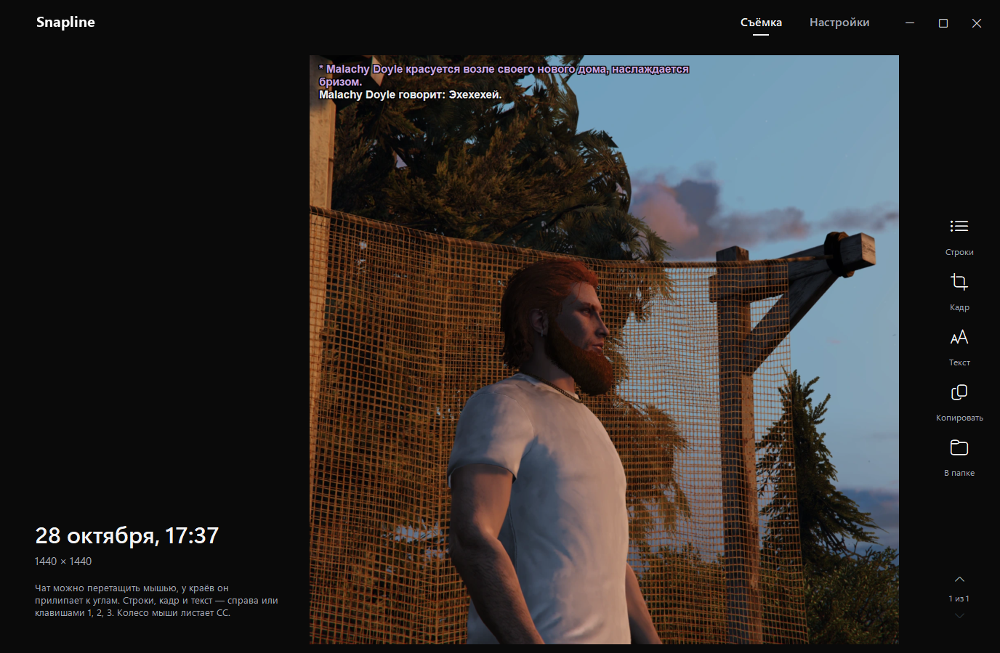
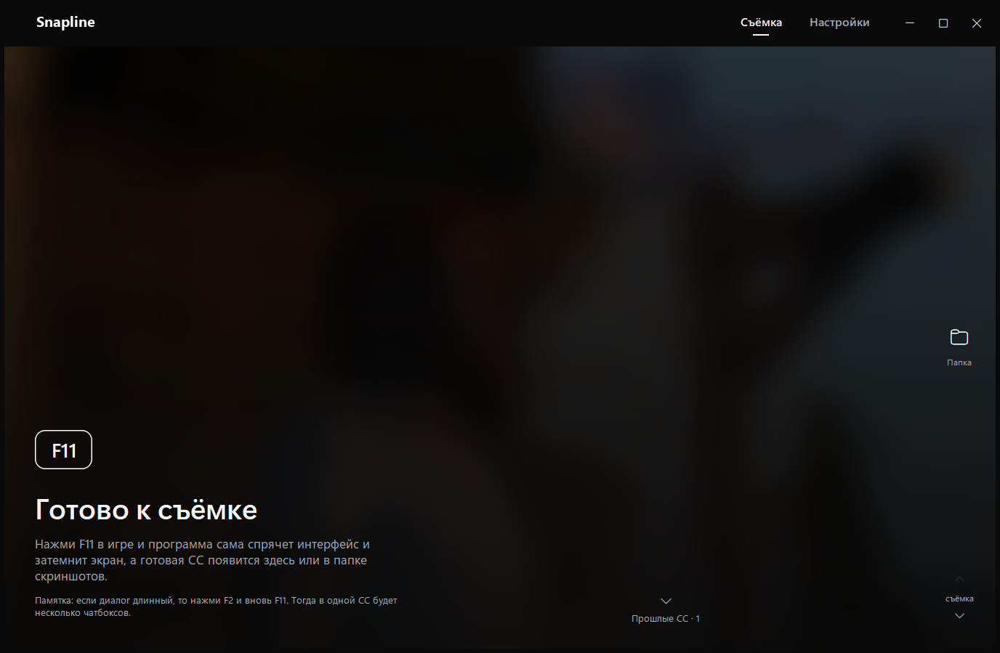
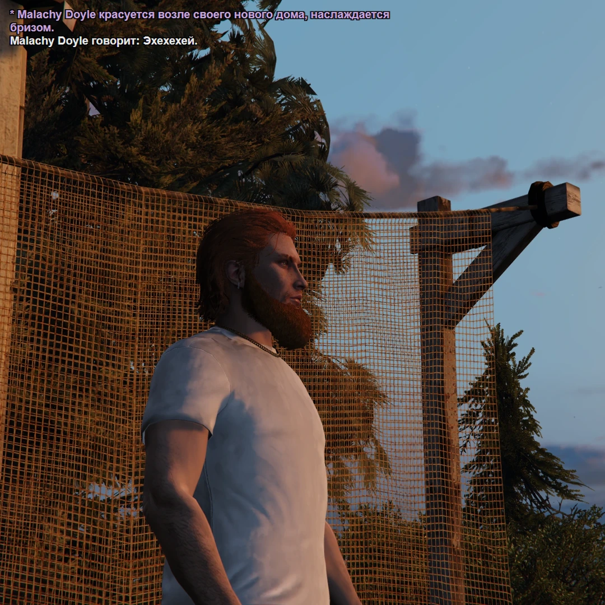
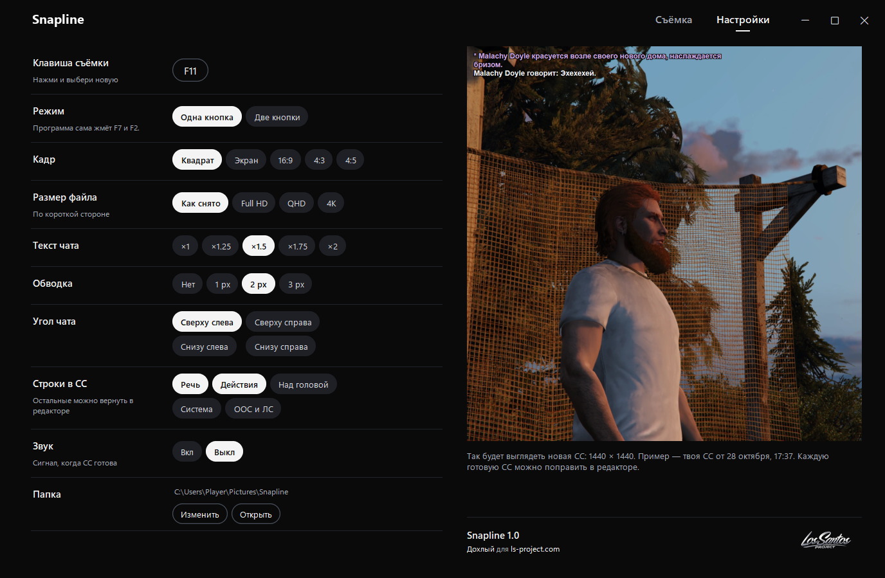

# Snapline

Скриншот-ситуации для [LS Project](https://ls-project.com/) по одной клавише.

Нажимаешь F11 в игре. Snapline сам прячет интерфейс, снимает сцену, затемняет экран, вырезает чат, оставляет в нём только отыгровку и кладёт его на кадр с обводкой. Готовая СС появляется в окне программы и в папке `Изображения\Snapline`. Если что-то не так, её можно поправить на месте: вернуть строку, сдвинуть чат, сменить кадр.



**[Скачать snapline.exe](https://github.com/dohliy-inc/Snapline/releases/latest)** · Windows 10 и 11 · без установки

## Установка

1. Скачай `snapline.exe` со страницы [релизов](https://github.com/dohliy-inc/Snapline/releases/latest).
2. Положи его в отдельную папку: рядом появится `config.ini` с настройками.
3. Запусти. Окно можно свернуть, F11 ловится и так.

Exe не подписан, поэтому при первом запуске Windows может показать «Система Windows защитила ваш компьютер». Нажми «Подробнее», затем «Выполнить в любом случае». Программа нажимает клавиши и снимает экран, за это её иногда не любят антивирусы. Весь код лежит в этом репозитории, exe собирается из него скриптом `build.bat`.

## Как снять СС



1. Запусти Snapline и зайди в игру.
2. Нажми F11. Программа нажмёт F7 (спрятать интерфейс), снимет сцену, нажмёт F2 (чёрный экран), снимет чат и вернёт всё как было.
3. Через пару секунд СС лежит в папке и в ленте программы.

Если диалог длинный и в чат не помещается, снимай его частями: нажми F2 и снова F11. Каждый такой кадр чата добавится к последней СС, повторяющиеся строки склеятся.

Вот что получается без единой правки:



## Что попадает в СС

По умолчанию остаётся только отыгровка.

| Строки | В СС |
| --- | --- |
| Речь: «говорит», «кричит», шёпот, телефон, транспорт | да |
| Действия `/me` и `/do` | да |
| Над головой, `/ame` (начинается с `>`) | нет |
| Системные: `>`, ошибки, PayDay, подключения, `/id` | нет |
| OOC `(( ))` и ЛС | нет |

Строки распознаются по форме и цвету символов прямо с экрана, текст не перепечатывается: в СС попадает тот же шрифт, что в игре. Набор строк меняется в настройках, а в редакторе любую убранную строку можно вернуть одним кликом.

## Редактор

Последняя СС открывается в ленте, справа инструменты:

| Инструмент | Клавиша | Что делает |
| --- | --- | --- |
| Строки | `1` | Все строки снятого чата. Клик убирает строку из СС или возвращает её |
| Кадр | `2` | Формат (квадрат, экран, 16:9, 4:3, 4:5), приближение до 2×, размер файла. Картинку можно тянуть мышью |
| Текст | `3` | Размер текста ×1–×2, обводка, угол чата |
| Копировать | `Ctrl+C` | Картинка в буфер обмена, сразу вставляется в Discord или на форум |
| В папке | | Открывает папку со СС |

Чат перетаскивается мышью и прилипает к углам. Колесо мыши и стрелки ↑ ↓ листают прошлые СС, `Esc` закрывает инструмент. Правки сохраняются сами, PNG в папке перерисовывается.

## Настройки



Справа живой пример: так будет выглядеть следующая СС с текущими настройками.

- **Клавиша съёмки.** F11 по умолчанию. Подойдут F1–F24, Pause, Insert, Home, End, PgUp и PgDn, кроме клавиш, которые заняты игрой.
- **Режим.** Одна кнопка или две, подробнее ниже.
- **Кадр и размер файла.** Размер считается по короткой стороне: как снято, Full HD, QHD или 4K.
- **Текст чата, обводка, угол чата.** Значения для новых СС, в редакторе их можно поменять у каждой отдельно.
- **Строки в СС, звук готовности, папка.**

Всё хранится в `config.ini` рядом с exe.

### Режим двух кнопок

По умолчанию Snapline сам нажимает F7 и F2. Если удобнее жать их самому, включи «Две кнопки», тогда программа только снимает:

1. F7, затем F11: сцена без интерфейса.
2. F2, затем F11: чат.

## Если что-то не работает

- **Вместо игры чёрный кадр или «чата на нём нет».** Поставь в настройках графики GTA V режим «Оконный без рамки».
- **«Игра не затемнилась по F2».** Проверь, что F2 в игре включает чёрный экран. Если FiveM запущен от имени администратора, запусти Snapline так же.
- **F11 ничего не делает, пока открыто окно Snapline.** Так и задумано: съёмка срабатывает, когда на переднем плане игра.
- Ошибки пишутся в `error.log` рядом с exe. С ним и описанием проблемы можно написать [автору](https://discord.com/users/320909791826280452).

## Сборка из исходников

Нужны Windows и Python 3.14 с лаунчером `py`.

```bat
build.bat
```

Скрипт создаёт `.venv`, ставит зависимости и PyInstaller, прогоняет тесты и собирает `dist\snapline.exe`. Запуск без сборки:

```bat
py -m venv .venv
.venv\Scripts\pip install -r requirements.txt
.venv\Scripts\python ui.py
```

| Файл | Что внутри |
| --- | --- |
| `ui.py` | Окно, лента, редактор, настройки. Точка входа |
| `core.py` | Горячая клавиша, съёмка, конфиг, сохранение СС |
| `chat.py` | Разбор чата с чёрного экрана, типы строк, склейка кадров, наложение с обводкой |
| `test_snapline.py` | Тесты на реальных кадрах из `tests/fixtures` |

## Лицензия

[MIT](LICENSE). Логотип LS Project в `assets/` принадлежит LS Project и под эту лицензию не попадает.
