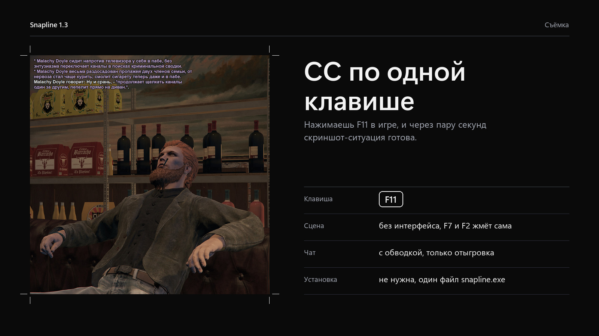
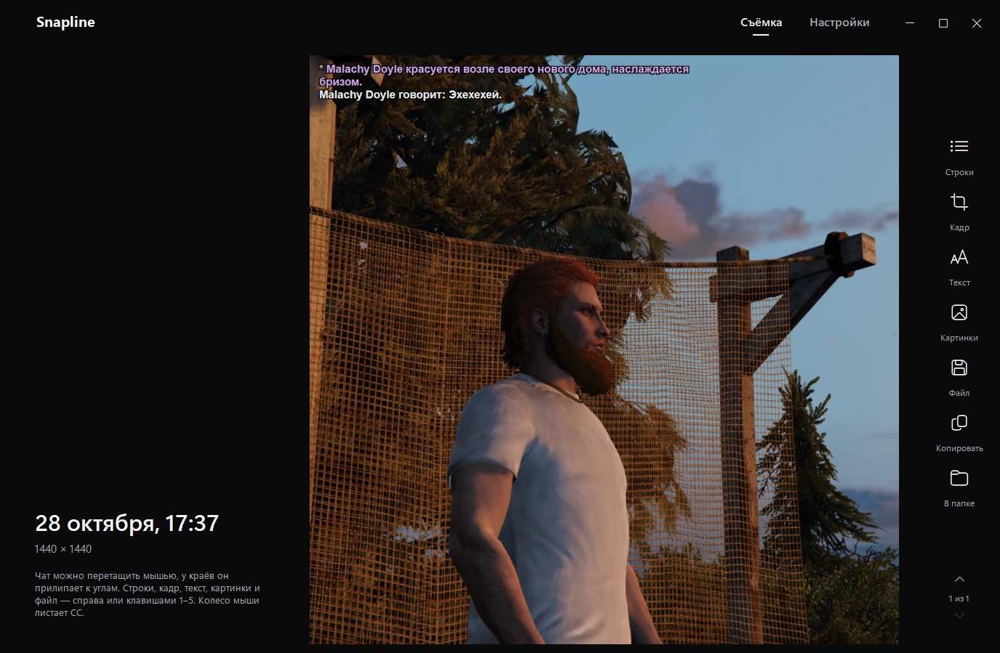
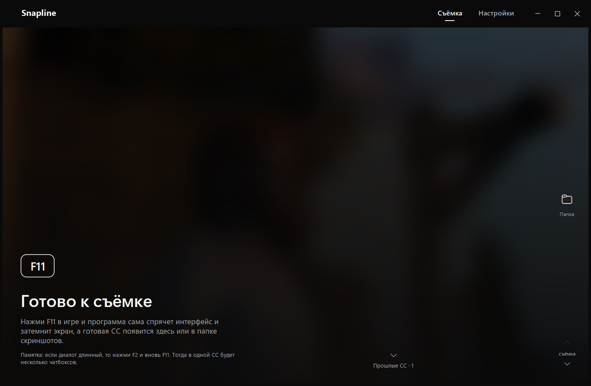
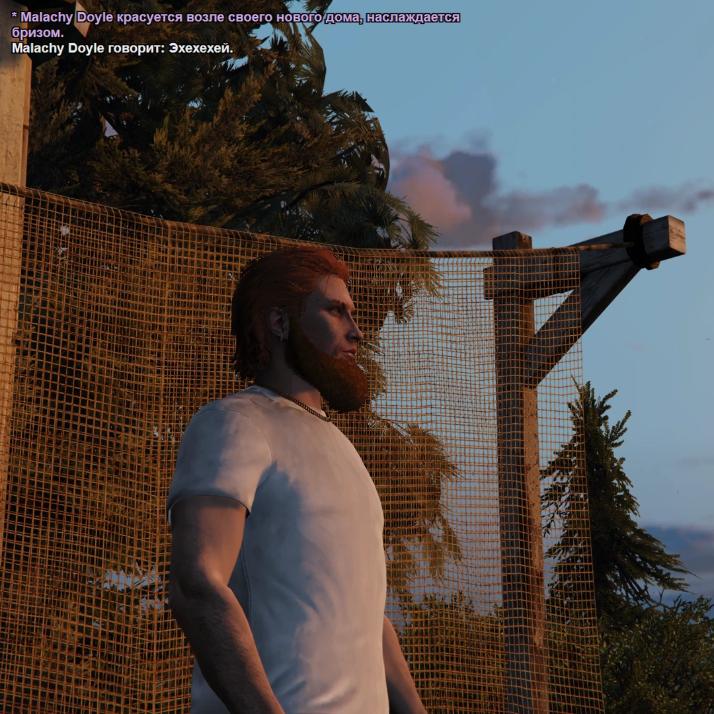
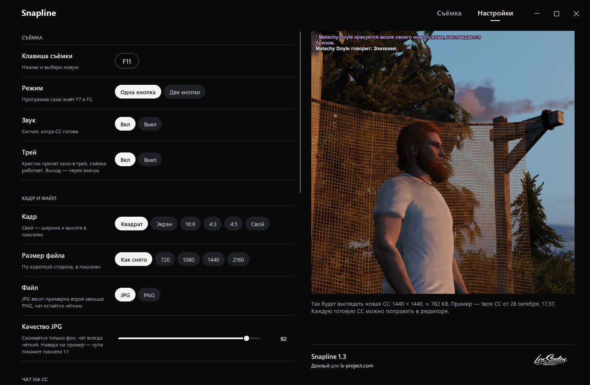

# Snapline

Скриншот-ситуации для [LS Project](https://ls-project.com/) по одной клавише.



Нажимаешь F11 в игре. Snapline сам прячет интерфейс, снимает сцену, затемняет экран, вырезает чат, оставляет в нём только отыгровку и кладёт его на кадр с обводкой. Готовая СС появляется в окне программы и в папке `Изображения\Snapline`. Если что-то не так, её можно поправить на месте: вернуть строку, сдвинуть чат, сменить кадр. А чатлог запишет весь чат игры в текстовый файл.

**[Скачать snapline.exe](https://github.com/dohliy-inc/Snapline/releases/latest)** · Windows 10 и 11 · без установки



## Установка

1. Скачай `snapline.exe` со страницы [релизов](https://github.com/dohliy-inc/Snapline/releases/latest).
2. Положи его в отдельную папку: рядом появится `config.ini` с настройками.
3. Запусти. Крестик прячет окно в трей, F11 ловится и так. Открыть окно или выйти — через значок в трее.

Exe не подписан, поэтому при первом запуске Windows может показать «Система Windows защитила ваш компьютер». Нажми «Подробнее», затем «Выполнить в любом случае». Программа нажимает клавиши и снимает экран, за это её иногда не любят антивирусы. Весь код лежит в этом репозитории, exe собирается из него скриптом `build.bat`.

Когда выходит новая версия, Snapline показывает ссылку на неё на главном экране и в настройках.

## Как снять СС



1. Запусти Snapline и зайди в игру.
2. Нажми F11. Программа нажмёт F7 (спрятать интерфейс), снимет сцену, нажмёт F2 (чёрный экран), снимет чат и вернёт всё как было.
3. Через пару секунд СС лежит в папке и в ленте программы.

Если диалог длинный и в чат не помещается, снимай его частями: нажми F2 и снова F11. Каждый такой кадр чата добавится к последней СС, повторяющиеся строки склеятся.

Можно снимать и без затемнения: в настройках «Чат» → «Из чатлога». Тогда F11 снимает только сцену, а строки потом выбираешь из записи чата, подробнее ниже.

Вот что получается без единой правки:



## Что попадает в СС

По умолчанию остаётся только отыгровка.

| Строки | В СС |
| --- | --- |
| Речь: «говорит», «кричит», шёпот, телефон, транспорт | да |
| Действия `/me` и `/do` | да |
| Над головой, `/ame` (начинается с `>`) | нет |
| Системные: `>`, ошибки, PayDay, подключения, `/id` | нет |
| OOC `(( ))` и ЛС | нет |

Строки распознаются по форме и цвету символов прямо с экрана, текст не перепечатывается: в СС попадает тот же шрифт, что в игре. Набор строк меняется в настройках, а в редакторе любую убранную строку можно вернуть одним кликом.

## Редактор

Последняя СС открывается в ленте, справа инструменты:

| Инструмент | Клавиша | Что делает |
| --- | --- | --- |
| Строки | `1` | Все строки снятого чата. Галочка убирает строку из СС или возвращает её, а если зажать кнопку мыши и провести, отметятся сразу несколько строк. Клик по слову открывает меню: закрыть слово плашкой, удалить его (текст длинной реплики подтягивается на освободившееся место) или убрать всю строку. Ножницы делят чат на сколько угодно частей: каждую можно поставить в свой угол, части в одном углу встают друг под другом. «Чат из другой СС» добавляет реплики из соседней СС: можно снять сцену с разных ракурсов и собрать текст на одном кадре. «Из чатлога» открывает запись чата за час до и после СС: отмеченные там строки заменяют снятый чат, «С экрана» возвращает снятый. В сцене здесь строки всех её СС по порядку, а «Убрать повторы» прячет строки, которые уже были в СС выше |
| Кадр | `2` | Формат (квадрат, экран, 16:9, 4:3, 4:5 или своя ширина × высота), размер и приближение до 3×. Картинку можно тянуть мышью, колесо приближает. В сцене формат и размер общие для всех её СС, а приближение и положение у каждой свои. «Расширить поле кадра» делает кадр больше в выбранную сторону, а СС остаётся своего размера: край СС мягко уходит в размытое продолжение, туда кладётся второй ракурс или переносится чат |
| Текст | `3` | Размер текста ×1–×2, обводка, отступ от края. Угол чата или каждой его части выбирается кликом по маленькому квадрату с четырьмя углами. В сцене размер, обводка и отступ меняются сразу во всех её СС |
| Картинки | `4` | Картинки поверх СС из файла, из буфера обмена или фон другой СС: второй ракурс, коллажи, стикеры. «Мягкие края» и «Прозрачность» растворяют фото в СС, как двойную экспозицию. Края у границы кадра остаются чёткими, и к границе картинка прилипает. Если поле кадра расширено, фото само встаёт на новое место с плавным переходом к СС. Тянешь мышью, колесо меняет размер. Белые метки по краям обрезают картинку, Shift + тянуть сдвигает обрезку. Обрезка свободная, под квадрат, 4:3, 16:9 и другие или точно в пикселях |
| Сцена | `5` | Несколько СС одна под другой с плавными переходами, как раскадровка для форума. Отмечаешь СС галочками: все они получают формат кадра этой СС, у каждой остаётся свой чат, а строки, которые уже были выше, убираются сами. Высота сцены — кадры друг под другом минус переходы. Порядок меняется стрелками. Строки, кадр, текст и картинки любой СС сцены правятся прямо в ней: нужная СС выбирается сверху в панели инструмента. Чат можно тянуть мышью прямо в собранной сцене (в «Сцене» или в «Тексте» → «Показывать: Всю сцену»): на переход или на другую СС, а в «Строках» у каждой СС есть переключатель «чат на СС N», который переносит её чат на соседнюю. Плавность, размытие и затемнение настраиваются для всех стыков сразу или для каждого отдельно: клик по стыку на картинке выбирает его. Сцену можно приближать до 400%, прокручивать колесом и двигать мышью. Если поправить одну из СС, сцена пересоберётся сама |
| Файл | `6` | JPG или PNG. У JPG ползунок качества: сжимается только фон, текст чата остаётся чётким. Картинка в редакторе показана точно как в файле, лупа под курсором показывает пиксели 1:1, рядом — вес файла |
| Копировать | `Ctrl+C` | Картинка в буфер обмена, сразу вставляется в Discord или на форум |
| В папке | | Открывает папку со СС |

Чат перетаскивается мышью, у любого края он встаёт на стандартный отступ, а в углу прилипает к углу. Стрелки ↑ ↓ листают прошлые СС, колесо мыши — тоже, пока инструмент закрыт: внутри инструмента колесо работает только с картинкой. Подсказка внизу картинки говорит, что можно сделать с тем, что под курсором. `Esc` закрывает инструмент. Правки сохраняются сами, файл СС в папке перерисовывается.

## Настройки



Справа живой пример: так будет выглядеть следующая СС с текущими настройками.

- **Клавиша съёмки.** F11 по умолчанию. Подойдут F1–F24, Pause, Insert, Home, End, PgUp и PgDn, кроме клавиш, которые заняты игрой.
- **Режим.** Одна кнопка или две, подробнее ниже.
- **Чат.** «С экрана» — чат снимается с затемнённого экрана. «Из чатлога» — F11 снимает только сцену, строки потом выбираешь из записи чата, чатлог при этом включается сам.
- **Кадр и размер файла.** Кадр: квадрат, экран, 16:9, 4:3, 4:5 или свой — ширина и высота в пикселях, от 200 до 7680. У готовых форматов размер считается по короткой стороне: как снято, 720, 1080, 1440 или 2160.
- **Файл.** JPG по умолчанию: весит примерно втрое меньше PNG, а цвет сохраняется без субдискретизации, поэтому чат остаётся чётким. PNG — без сжатия.
- **Качество JPG.** 92 по умолчанию. Ниже — сильнее сжимается фон, а текст чата сохраняется в прежнем качестве: на 50 файл легче примерно на треть, на 15 — вдвое. Под примером справа виден вес файла, при наведении лупа показывает пиксели 1:1.
- **Текст чата, обводка, угол чата, отступ от края.** Значения для новых СС, в редакторе их можно поменять у каждой отдельно.
- **Ники.** «Прятать» закрывает имена персонажей плашками в каждой новой СС: в речи, `/me` и `/do`.
- **Трей.** Включён по умолчанию: крестик прячет окно в трей, а не закрывает программу. Повторный запуск `snapline.exe` открывает уже запущенное окно.
- **Строки в СС, звук готовности, папка.**
- **Исходники.** В `src` рядом со СС лежат кадры, из которых она собрана: сцена в JPG и чат в WebP без потерь. Без них СС не поправить в редакторе. Кнопка «Очистить» удаляет их, готовые СС остаются.
- **Чатлог.** Записывает чат игры в `chatlog\ГГГГ-ММ-ДД.txt` рядом со СС, по файлу на день. Рядом в `.jsonl` лежат те же строки с цветами.

Всё хранится в `config.ini` рядом с exe.

### Чатлог

Пока Snapline открыт, а чатлог включён, программа записывает каждую строку чата с временем:

```text
[16:22:21] Malachy Doyle говорит (тихо): Тихо.
[16:22:34] Окружение. *Malachy Doyle
[16:23:24] > Данная команда не найдена. Воспользуйтесь главным меню, для поиска команды.
```

Текст берётся со страницы чата через встроенный отладчик страниц FiveM (`127.0.0.1:13172`), поэтому в лог попадает всё, что пришло в чат, а не только то, что видно на экране. В игре программа при этом ничего не нажимает. Статус виден в настройках: «Жду FiveM», «Чат найден, пишу». Если игру перезапустить, запись продолжится сама.

### СС из чатлога

Если в настройках выбрано «Чат» → «Из чатлога», F11 только прячет интерфейс и снимает сцену, экран не затемняется, чат на СС пока пустой. Открой «Строки»: там сразу откроется чатлог за час до и после СС, так что сцену можно отыграть и после снимка. Строки разбиты на куски по паузам в разговоре, пунктир показывает момент съёмки. По умолчанию видна только отыгровка, «Все строки» покажет и системные. Если рядом шло несколько разговоров, нажми слева на участников своей сцены: останется только их диалог. Отметь нужные строки (клик по заголовку куска отмечает его целиком) и нажми «На СС». Строки встанут в чат тем же шрифтом и цветом, что в игре: красить и вставлять ничего не нужно. Дальше всё как обычно: углы, части, размер текста, плашки на ники. Чтобы поменять набор строк, снова нажми «Из чатлога», прошлые отметки сохраняются.

Кнопка «Из чатлога» есть и в «Строках» у любой СС, снятой с экрана: пригодится, если нужные строки уже уехали из чата. Выбранные строки заменят снятый чат, «С экрана» вернёт его. Строки берутся только из записи, поэтому чатлог должен быть включён во время игры.

### Режим двух кнопок

По умолчанию Snapline сам нажимает F7 и F2. Если удобнее жать их самому, включи «Две кнопки», тогда программа только снимает:

1. F7, затем F11: сцена без интерфейса.
2. F2, затем F11: чат.

## Если что-то не работает

- **Вместо игры чёрный кадр или «чата на нём нет».** Поставь в настройках графики GTA V режим «Оконный без рамки».
- **«Игра не затемнилась по F2».** Проверь, что F2 в игре включает чёрный экран. Если FiveM запущен от имени администратора, запусти Snapline так же.
- **«Windows не даёт записать в папку».** Обычно папку «Изображения» защищает «Контролируемый доступ к папкам» в Защитнике Windows. Выбери в настройках другую папку, например `D:\Snapline`, или разреши `snapline.exe` в Защитнике: Безопасность Windows → Защита от вирусов и угроз → Управление защитой от программ-шантажистов.
- **F11 ничего не делает, пока открыто окно Snapline.** Так и задумано: съёмка срабатывает, когда на переднем плане игра.
- Ошибки пишутся в `error.log` рядом с exe. С ним и описанием проблемы можно написать [автору](https://discord.com/users/320909791826280452).

## Сборка из исходников

Нужны Windows и Python 3.14 с лаунчером `py`.

```bat
build.bat
```

Скрипт создаёт `.venv`, ставит зависимости и PyInstaller, прогоняет тесты и собирает `dist\snapline.exe`. Запуск без сборки:

```bat
py -m venv .venv
.venv\Scripts\pip install -r requirements.txt
.venv\Scripts\python ui.py
```

| Файл | Что внутри |
| --- | --- |
| `ui.py` | Окно, лента, редактор, настройки. Точка входа |
| `core.py` | Горячая клавиша, съёмка, конфиг, сохранение СС |
| `chat.py` | Разбор чата с чёрного экрана, типы строк, склейка кадров, наложение с обводкой |
| `chatlog.py` | Чатлог через отладчик страниц FiveM. Запускается и отдельно: `python chatlog.py` |
| `test_snapline.py` | Тесты на реальных кадрах из `tests/fixtures` |

## Лицензия

[MIT](LICENSE). Логотип LS Project в `assets/` принадлежит LS Project и под эту лицензию не попадает.
